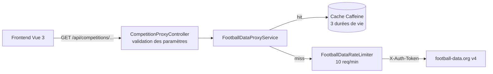

# ⚽ Dashboard Foot — Backend

API Spring Boot qui relaie [football-data.org](https://www.football-data.org/) pour le frontend [Dashboard Foot](https://github.com/foucouthibault/Dashboard-foot). Elle garde la clé d'API côté serveur, met les réponses en cache et fait respecter le quota de l'offre gratuite (10 requêtes par minute).

**▶ Démo : https://dashboard-foot-frontend.netlify.app** (API publique : https://dashboard-foot-backend.onrender.com  ; une surveillance toutes les 5 minutes empêche le backend gratuit de se mettre en veille)

[](https://github.com/foucouthibault/Dashboard-foot-backend/actions/workflows/maven.yml)


[](./LICENSE)

## Architecture



## Endpoints

| Méthode | Route | Paramètres | Cache |
|---|---|---|---|
| `GET` | `/api/competitions/{id}` | — | 60 s |
| `GET` | `/api/competitions/{id}/standings` | `season` (optionnel, ex. `2025`) | 5 min, ou 24 h pour une saison terminée |
| `GET` | `/api/competitions/{id}/matches` | — | 60 s |
| `GET` | `/api/competitions/{id}/scorers` | `limit`, `season` (optionnels) | 5 min, ou 24 h pour une saison terminée |

`{id}` accepte un code (`FL1`, `PL`…) ou un identifiant numérique (`2015`). Un `id` qui ne correspond pas à `^[a-zA-Z0-9_-]+$` ou une `season` qui n'est pas une année sur 4 chiffres renvoient `400`.

Un endpoint de santé, `GET /actuator/health`, répond `{"status":"UP"}` pour le contrôle de l'hébergeur. Il n'appelle jamais football-data.org et ne consomme donc pas de quota. Aucun autre endpoint Actuator n'est exposé. Les métriques (Micrometer) sont exclues de la dépendance Actuator : elles ne servent pas et apportaient HdrHistogram 2.2.2, touché par CVE-2026-14686 sans version corrigée.

Le contrat complet (routes, paramètres, schémas des réponses et des erreurs) est décrit en OpenAPI 3 :

- Swagger UI : http://localhost:8080/swagger-ui.html ;
- spécification : http://localhost:8080/v3/api-docs ;
- copie versionnée : [`openapi.json`](./openapi.json), d'où le frontend tire ses types.

Les réponses reprennent la structure de football-data.org, réduite aux champs qu'affiche le frontend (records Java du paquet `model`, alignés sur `src/types/index.ts` du frontend). Les autres champs de l'API sont ignorés. Les erreurs sont des `ProblemDetail` ([RFC 9457](https://www.rfc-editor.org/rfc/rfc9457)), toujours en `application/problem+json` : `{"title": "Bad Request", "status": 400, "detail": "Format de saison invalide"}`.

## Choix techniques

- **Un quota global, pas par visiteur.** `FootballDataRateLimiter` applique une fenêtre glissante d'une minute à tous les appels sortants réels. Quand le quota est atteint, l'API répond `429` avec un en-tête `Retry-After` au lieu de se faire bloquer par football-data.org. Les réponses servies depuis le cache ne comptent pas dans le quota.
- **Un cache adapté à chaque type de donnée** (`CacheConfig`) :
  - 60 s pour les compétitions et les matchs ;
  - 5 min pour les classements et buteurs de la saison en cours ;
  - 24 h pour les saisons terminées, qui ne changent plus.
- **Seules les réponses réussies sont mises en cache.** Une erreur passagère (`429`, panne réseau) ne reste pas figée jusqu'à la fin de la durée de vie du cache.
- **Un seul appel pour tous les `limit` de buteurs.** Le service demande toujours 50 buteurs à l'API puis découpe la liste selon le `limit` demandé. Changer de `limit` côté frontend ne consomme donc jamais de quota.
- **Des réponses typées.** Le service désérialise la réponse de l'API dans des records, met ces objets en cache et découpe la liste des buteurs sans repasser par le JSON. Une réponse réussie mais vide ou illisible est traitée comme une panne (`502`) et n'est pas mise en cache.
- **Des erreurs au format standard.** Le service signale les erreurs par des exceptions, traduites en `ProblemDetail` par `ApiExceptionHandler`, qui étend `ResponseEntityExceptionHandler` pour que les erreurs de Spring MVC (paramètre mal typé…) aient le même format. Un statut d'erreur de l'API (saison hors offre, quota dépassé…) est renvoyé tel quel ; son corps est journalisé mais pas transmis. Une panne réseau donne un `502` sans exposer le message de l'exception.
- **Un contrat versionné.** springdoc produit la spécification OpenAPI à partir du contrôleur et des records. `OpenApiContractTest` la réécrit dans `openapi.json` à chaque build et échoue si le fichier versionné était différent : un changement de contrat ne passe pas la CI sans que `openapi.json` soit committé. Le frontend vérifie en CI que ses types sont compatibles avec ce fichier. Tous les champs des réponses y sont obligatoires (Jackson sérialise aussi les `null`) ; ceux qui peuvent valoir `null` portent `@Schema(nullable = true)`.
- **CORS fermé par défaut.** En développement, le frontend passe par le proxy Vite (même origine). En ligne, son domaine doit figurer dans `app.cors.allowed-origins`, et seules les requêtes `GET` sur `/api/**` sont autorisées, avec les en-têtes `Accept`, `Accept-Language` et ceux du suivi Sentry du frontend (`sentry-trace`, `baggage`). L'en-tête `Retry-After` d'un `429` est exposé (`Access-Control-Expose-Headers`) pour que le frontend puisse afficher le délai d'attente. Une origine absente de la liste reçoit un `403` sans atteindre le contrôleur, donc sans consommer de quota.
- **Erreurs remontées dans Sentry, triées.** Le SDK n'est actif que si `SENTRY_DSN` est renseignée (production) ; en local, en CI et dans les tests, rien n'est envoyé. Partent vers Sentry : les exceptions non gérées, les pannes de football-data.org (`502`) et un `429` renvoyé par football-data.org (le limiteur interne a laissé passer trop d'appels : bug, et risque de blocage de la clé). Ne partent pas : le `429` du limiteur interne (comportement voulu), les requêtes invalides (`400`), les `403` et `404` relayés (saison hors offre, compétition inconnue). Chaque événement porte l'environnement et la version (commit déployé). `SentryEventFilter` retire en-têtes, cookies et adresse du client, en plus de `sentry.send-default-pii=false`.
- **Sécurité :**
  - le jeton reste côté serveur ;
  - seuls les en-têtes `Accept` et `Accept-Language` du client sont relayés, et aucun en-tête de la réponse de l'API n'est renvoyé au client ;
  - les paramètres sont validés ;
  - l'URL sortante est vérifiée (même schéma, hôte et port que l'URL configurée) pour empêcher toute requête vers un autre serveur (SSRF).

## Démarrage rapide

### Prérequis

- Java 25 (Maven est fourni par le wrapper `./mvnw`)
- Une clé football-data.org ([inscription gratuite](https://www.football-data.org/client/register))

### Lancer l'application

```bash
git clone https://github.com/foucouthibault/Dashboard-foot-backend.git
cd Dashboard-foot-backend
FOOTBALL_DATA_API_TOKEN=votre_cle ./mvnw spring-boot:run
```

L'API écoute sur http://localhost:8080 :

```bash
curl http://localhost:8080/api/competitions/FL1/standings
```

Sans clé, l'application démarre quand même, mais football-data.org refusera ou limitera les appels.

Pour l'interface, lancer ensuite le [frontend](https://github.com/foucouthibault/Dashboard-foot) : son serveur de développement relaie `/api` vers ce backend.

### Avec Docker

Seul Docker est nécessaire (ni Java ni Maven) :

```bash
docker build -t dashboard-foot-backend .
docker run -p 8080:8080 -e FOOTBALL_DATA_API_TOKEN=votre_cle dashboard-foot-backend
```

- **Deux étapes.** L'image compile le projet sur le JDK 25, puis ne garde que le JRE 25 et le jar (Alpine, environ 360 Mo).
- **Ni clé ni tests dans l'image.** La clé n'est jamais copiée dans l'image : elle est passée au lancement avec `-e`. Les tests ne tournent pas pendant la construction (ils tournent en CI).
- **Utilisateur non root,** port `8080`.
- **Contrôle de santé Docker** (`HEALTHCHECK`) sur `/actuator/health`, qui n'appelle jamais football-data.org.
- **Mémoire :** la JVM limite son tas à 75 % de la mémoire du conteneur (`-XX:MaxRAMPercentage=75`).
- **Configuration :** toute propriété du tableau ci-dessous se passe par variable d'environnement, par exemple `-e APP_CORS_ALLOWED_ORIGINS=https://...`.

## Configuration

Toutes les valeurs sont dans `src/main/resources/application.properties` et peuvent être surchargées par variable d'environnement ou argument `--propriete=valeur`.

| Propriété | Défaut | Rôle |
|---|---|---|
| `football-data.api.token` | variable `FOOTBALL_DATA_API_TOKEN` | Clé d'API football-data.org |
| `football-data.api.base-url` | `https://api.football-data.org/v4` | URL de l'API |
| `football-data.api.rate-limit-per-minute` | `10` | Quota d'appels sortants par minute |
| `football-data.cache.static-ttl-seconds` | `60` | Cache des compétitions et matchs |
| `football-data.cache.current-season-ttl-seconds` | `300` | Cache de la saison en cours |
| `football-data.cache.historical-season-ttl-hours` | `24` | Cache des saisons terminées |
| `app.cors.allowed-origins` | vide (variable `APP_CORS_ALLOWED_ORIGINS`) | Origines autorisées à appeler `/api/**` en `GET` depuis un navigateur, séparées par des virgules (ex. `https://dashboard-foot.example`). Vide : aucune origine externe |
| `sentry.dsn` | vide (variable `SENTRY_DSN`) | Projet Sentry qui reçoit les erreurs. Vide : Sentry désactivé |
| `sentry.environment` | `local` (variable `SENTRY_ENVIRONMENT`) | Environnement affiché dans Sentry (`production` sur Render) |
| `sentry.release` | variable `RENDER_GIT_COMMIT`, sinon version Maven | Version de l'application dans Sentry |
| `sentry.send-default-pii` | `false` | Ni adresse IP, ni en-têtes, ni cookies dans les événements |
| `logging.structured.format.console` | vide (variable `LOG_FORMAT`) | Format des logs : vide pour le texte lisible, `logstash` pour une ligne JSON par événement (production, voir [Logs](#logs)) |
| `management.endpoints.web.exposure.include` | `health` | Endpoints Actuator exposés : seulement la santé, sans détails |
| `springdoc.swagger-ui.enabled` | `true` | Publie Swagger UI sur `/swagger-ui.html` |
| `server.port` | `8080` | Port HTTP |

## Déploiement

L'API est en ligne sur **https://dashboard-foot-backend.onrender.com** (par exemple [`/api/competitions/FL1`](https://dashboard-foot-backend.onrender.com/api/competitions/FL1)).

- **Hébergeur : [Render](https://render.com), offre gratuite, région Francfort.** Choisi plutôt que Fly.io parce que Render garde une offre gratuite sans carte bancaire, construit l'image directement depuis le `Dockerfile` du dépôt et se configure par un fichier versionné.
- **Configuration :** [`render.yaml`](./render.yaml) (Blueprint). Il décrit le service Docker, le contrôle de santé sur `/actuator/health` et le port `8080`.
- **Secrets :** `FOOTBALL_DATA_API_TOKEN`, `APP_CORS_ALLOWED_ORIGINS` et `SENTRY_DSN` sont déclarés en `sync: false`. Leurs valeurs se saisissent dans le tableau de bord Render (*Environment*), jamais dans le dépôt.
- **Sentry :** `SENTRY_ENVIRONMENT=production` est fixé dans `render.yaml`, et Render fournit `RENDER_GIT_COMMIT`, utilisé comme version. Sans `SENTRY_DSN`, le service tourne normalement, sans remonter ses erreurs.
- **Redéployer :** automatique à chaque commit sur la branche suivie par le Blueprint, une fois la CI GitHub passée (`autoDeployTrigger: checksPass`). À la main : *Manual Deploy → Deploy latest commit* dans le tableau de bord. Une modification de `render.yaml` s'applique à la synchronisation suivante du Blueprint.
- **Mise en veille :** sur l'offre gratuite, le service s'arrête après 15 minutes sans requête. La requête suivante le réveille en environ **1 min 40 s** (96 s mesurées le 3 novembre 2026, contre 0,1 s une fois éveillé). Le contrôle de disponibilité ci-dessous interroge le backend toutes les 5 minutes, ce qui l'empêche de s'endormir : une démo ne doit pas faire attendre son premier visiteur. Un service allumé en permanence consomme au plus 744 h par mois, dans les 750 h gratuites de Render, à condition qu'il soit le seul service gratuit du compte. Le backend redémarre toutefois à chaque déploiement : le frontend prévient donc toujours l'utilisateur quand une réponse tarde. Le cache étant en mémoire, il repart vide après chaque redémarrage.
- **Surveillance de la disponibilité : [UptimeRobot](https://uptimerobot.com), offre gratuite.** Choisi pour son offre gratuite sans carte bancaire, qui contrôle toutes les 5 minutes, vérifie un mot-clé dans la réponse et alerte par mail. Better Stack aurait aussi convenu. Deux contrôles HTTPS, toutes les 5 minutes, avec une alerte par mail à la panne puis au retour :

  | Contrôle | URL | Attendu |
  |---|---|---|
  | Backend | `https://dashboard-foot-backend.onrender.com/actuator/health` | `200` et le mot-clé `"status":"UP"` |
  | Frontend | `https://dashboard-foot-frontend.netlify.app/` | `200` et le mot-clé `<div id="app">` |

  Le code `200` seul ne suffit pas : une page d'erreur ou d'attente d'un hébergeur peut le renvoyer, et Netlify répond `200` même pour une page inexistante (renvoi de l'appli monopage vers `index.html`). Le contrôle de santé n'appelle jamais football-data.org : il ne consomme aucun quota. **Aucune route `/api/**` n'est surveillée**, car chaque contrôle en consommerait.

## Logs

En local et dans les tests, les logs restent au format texte de Spring Boot. Sur Render, `LOG_FORMAT=logstash` (fixé dans `render.yaml`) produit **une ligne JSON par événement** :

```json
{"@timestamp":"2026-11-12T22:46:24.54+01:00","level":"WARN","logger_name":"fr.foucouthibault.dashboardfoot.service.FootballDataProxyService","message":"football-data.org a répondu 403 FORBIDDEN pour https://api.football-data.org/v4/competitions/FL1: …","requestId":"0f6c1d1e-…","event":"amont_erreur","upstreamStatus":403}
```

- **`requestId`** : identifiant de la requête, présent sur toutes les lignes écrites pendant celle-ci. Il est renvoyé au client dans l'en-tête `X-Request-Id` (lisible par le frontend en CORS). Un `X-Request-Id` entrant est repris s'il fait au plus 64 caractères parmi lettres, chiffres, `.`, `_` et `-` ; sinon un UUID est généré.
- **`event`** : nom stable d'un événement notable, indépendant du texte du message :

| `event` | Niveau | Champs | Quand |
|---|---|---|---|
| `cache_manque` | `INFO` | `cache`, `cacheKey` | Réponse absente du cache : suit un appel à football-data.org ou un refus du limiteur. `INFO` car le volume est borné par le quota (10 appels/minute) |
| `quota_atteint` | `WARN` | `retryAfter` (secondes) | Le limiteur interne refuse l'appel, le client reçoit un `429` |
| `amont_erreur` | `WARN` | `upstreamStatus` | football-data.org a répondu par une erreur (`403`, `404`, `429`…), relayée au client |
| `amont_indisponible` | `WARN` | `stack_trace` | Panne réseau, réponse vide ou illisible, le client reçoit un `502` |
| `url_refusee` | `WARN` | | URL sortante rejetée par le contrôle SSRF |

**Rien de sensible** : ni clé d'API, ni adresse IP, ni en-têtes de requête. Les URL et corps de réponse amont sont débarrassés de leurs caractères de contrôle avant d'être écrits.

**Rechercher dans Render** (*Logs*, champ de recherche plein texte) :

- toutes les saturations du quota : `"event":"quota_atteint"` ;
- les erreurs de football-data.org : `"event":"amont_erreur"`, ou un statut précis : `"upstreamStatus":429` ;
- toutes les lignes d'une requête signalée par le frontend : `"requestId":"<valeur de X-Request-Id>"`.

## Tests

```bash
./mvnw test
```

Les tests ne demandent ni clé d'API ni accès réseau (l'API est simulée) :

- **Contrat OpenAPI** (`OpenApiContractTest`) : `openapi.json` à jour, 4 routes, paramètres, erreurs en `ProblemDetail`, champs obligatoires et `nullable`, Swagger UI servie.
- **Couche HTTP** (`CompetitionProxyHttpTest`) : statut, en-têtes et corps vus par le frontend sur les 4 routes, dont les champs renvoyés et ceux qui sont écartés.
- **Logs** (`StructuredLoggingTest`, `FootballDataProxyServiceEventsTest`, `RequestIdFilterTest`) : en format JSON, chaque ligne d'une requête est un objet JSON avec son `requestId`, sans clé d'API ni adresse IP ; chaque événement nommé est produit avec ses champs ; un `X-Request-Id` entrant dangereux ou trop long est remplacé.
- **Contrôleur** : rejet des identifiants invalides (caractères spéciaux, `/`, injection SQL, remontée de répertoire) et transmission des paramètres.
- **Service** :
  - utilisation du cache, et une clé de cache par saison ;
  - choix du bon cache selon la saison ;
  - erreurs non mises en cache ;
  - transmission des statuts d'erreur ;
  - `429` quand le quota est atteint ;
  - découpage des buteurs.
- **Santé** (`ActuatorHealthTest`) : `/actuator/health` répond `{"status":"UP"}` sans détails ni appel à football-data.org, aucun autre endpoint Actuator n'est exposé.
- **CORS** (`CorsConfigTest`) : en-tête `Access-Control-Allow-Origin` pour une origine autorisée seulement, `GET` uniquement (requête simple et preflight), `Retry-After` et `X-Request-Id` exposés, en-têtes `sentry-trace` et `baggage` acceptés et tout autre en-tête refusé, rien sans configuration.
- **Sentry** (`SentryReportingTest`, `SentryDisabledTest`, `SentryEventFilterTest`) : le transport est remplacé par un enregistreur, aucun événement ne quitte la machine. Sans DSN, rien n'est envoyé ; avec un DSN, les erreurs attendues sont écartées, les autres partent avec environnement et version, sans en-têtes, cookies, adresse IP ni clé.
- **Limiteur de débit** : quota dans la fenêtre, libération des places, calcul de `Retry-After`. Le temps est simulé avec une `Clock` injectée.

La CI GitHub Actions compile le projet et lance les tests à chaque push et chaque pull request. Elle construit aussi l'image Docker sans la publier, puis vérifie que le conteneur démarre et répond `UP` sur `/actuator/health`. Dependabot maintient les dépendances à jour.

## Structure du projet

```
src/main/java/fr/foucouthibault/dashboardfoot/
├── config/
│   ├── AppConfig.java                  # RestTemplate
│   ├── CacheConfig.java                # Les trois caches Caffeine
│   ├── CorsConfig.java                 # Origines autorisées (CORS)
│   ├── OpenApiConfig.java              # Description OpenAPI (springdoc)
│   ├── RequestIdFilter.java            # requestId dans le MDC et l'en-tête X-Request-Id
│   ├── SentryConfig.java               # Branche le filtre sur le SDK Sentry
│   └── SentryEventFilter.java          # Tri des erreurs et retrait des données personnelles
├── controller/
│   ├── ApiExceptionHandler.java        # Exceptions traduites en réponses HTTP
│   └── CompetitionProxyController.java # Routes /api/competitions et validation
├── exception/                          # Erreurs du service et du contrôleur
├── model/                              # Records des réponses (champs lus par le frontend)
└── service/
    ├── FootballDataProxyService.java   # Appel à l'API, cache, erreurs, sécurité SSRF
    └── FootballDataRateLimiter.java    # Limite de débit à fenêtre glissante
Dockerfile                              # Image en deux étapes (JDK 25 → JRE 25)
openapi.json                            # Contrat de l'API, régénéré par les tests
render.yaml                             # Déploiement sur Render (Blueprint)
```

## Limites connues et pistes

- **Cache et quota en mémoire.** Ils sont perdus au redémarrage et propres à chaque instance. Piste : un cache persistant (PostgreSQL ou Redis).
- **Saison terminée ou en cours ?** Le calcul se fait à partir de l'année civile, donc il est approximatif en juillet-août. Au pire, une saison encore active reste en cache un peu plus longtemps que nécessaire.

## Licence

[MIT](./LICENSE)
